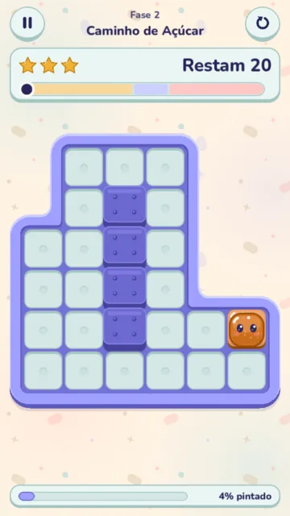

<p align="center">
  
</p>

<h1 align="center">Trilha Jujuba</h1>

<p align="center"><strong>A cozy slide-and-paint puzzle game. Swipe the jellies and paint each tile of the board.</strong></p>

<p align="center">
  <a href="https://godotengine.org/"></a>
  
  
  <a href="LICENSE"></a>
</p>

> A free portrait mobile game, made with Godot 4.7.2 and GDScript. Each sound and each piece of music comes from code.

<p align="center">
  
  
  
</p>

## The game

- Each level is a board of floor tiles, with walls and obstacles.
- One to four jellies sit on the board. Each jelly has its own color.
- Swipe to move the jellies. Each tile that a jelly touches takes its color.
- Paint all the floor tiles to complete the level. Use as few moves as possible to get three stars.
- The game has 8 levels, a star score for each level and a record of your best result.
- The interface text is in Brazilian Portuguese.

## Gallery

| | |
|---|---|
|  |  |
| The level select screen shows your stars. A level opens when you get one star on the level before it. | Level 8 at the start, with four jellies, obstacles and curved rails. |
|  |  |
| All the jellies slide at the same time and paint their path. | The last tile starts the win wave across the board. |
|  |  |
| Near the move limit, the HUD turns red and the music becomes tense. | When the moves stop, the defeat card shows how much of the path you painted. |
|  |  |
| The pause dialog holds the music, sound, vibration and reduced motion switches. | The first levels teach the rules with one jelly. |

## Contents

- [The game](#the-game)
- [Gallery](#gallery)
- [How to play](#how-to-play)
- [Features](#features)
- [Download](#download)
- [Build from source](#build-from-source)
- [For developers](#for-developers)
- [License](#license)

## How to play

### The swipe

- Swipe up, down, left or right. On a computer, use the arrow keys or WASD.
- All the jellies move in the same direction, at the same time.
- A jelly slides until a wall, an obstacle or a stopped jelly stops it.
- A curved rail turns a jelly to a new direction while it slides.
- When two jellies go to the same tile, one jelly goes first and the other stops behind it.

### The paint

- Each jelly starts on a tile that already has its color.
- Each tile that a jelly enters takes the color of that jelly.
- A jelly can paint a tile again with a different color. The tile stays painted.
- The bar at the bottom of the screen shows the painted percentage.

### Moves

- A swipe counts as a move only when at least one jelly changes its position.
- A swipe into a wall does not count. The jellies only give a small nudge.
- Each level has a move limit. The HUD shows the moves that remain ("Restam").
- Near the limit, the tension starts: the meter turns red and the music changes.

### Win, lose and stars

- You win when each floor tile has paint.
- You lose when you use all the moves and some tiles have no paint. There is no time limit.
- The game knows the minimum number of moves for each level. A solver calculates it.
- You get 3 stars near the minimum, 2 stars with some more moves and 1 star up to the limit.
- The move meter shows the star ranges. When a move drops a star, the star falls from the HUD.
- The result card shows your time, your moves and the move range for 3 stars.

## Features

- **8 levels** with 1 to 4 jellies, obstacles and curved rails. Each level has a name.
- **Star score and records.** The game keeps the stars, the best move count and the best time of each level.
- **Procedural audio.** A script makes all 17 sound effects and the 2 music loops from code. The game keeps them as WAV files.
- **Adaptive music.** A calm loop plays during the level. The tense loop starts near the move limit, on the beat.
- **The music opens as you paint.** A filter on the music opens as the board fills with paint.
- **Juice.** Squash on stop, paint splashes, impact rings, board shake, hit-stop, glitter and confetti.
- **Win and defeat ceremonies.** The tiles jump in a wave when you win. When you lose, the jellies deflate and the empty tiles pulse. A tap skips a ceremony.
- **Live demo board.** The home screen plays a small level again and again behind the buttons.
- **Reduced motion.** A switch in the pause dialog makes the shake, the waves, the hit-stop and the particles smaller.
- **Haptics.** A short vibration when the jellies stop, on phones only. A switch in the pause dialog turns it off.
- **Performance panel.** Press F3, or long-press the "Pausa" title in the pause dialog. It shows FPS, frame, script, draw and render times, draw calls and the device and GPU names.
- **Light on the GPU.** The board art and the vector UI art are baked into atlases, to keep the draw calls low on phones.
- **Keyboard.** Arrow keys or WASD to swipe, R to restart, Esc or P to pause, F3 for the performance panel.

## Download

Get the Android APK and the Windows EXE from the [latest release](https://github.com/salvimateus/slide-blocks-the-game/releases/latest).

> [!NOTE]
> The Windows EXE has no code signing certificate. Windows can show "Windows protected your PC" at the first start. Click "More info", then "Run anyway".

## Build from source

### Requirements

- [Godot 4.7.2](https://godotengine.org/download/archive/) (standard build, not .NET).
- The Godot 4.7.2 export templates, for the exports.
- For Android: the Android SDK and a Java JDK 17, set in the Godot editor settings.

### Open the project

```sh
git clone https://github.com/salvimateus/slide-blocks-the-game.git
```

1. Start Godot 4.7.2.
2. Click "Import" and select the `project.godot` file of the clone.
3. Press F5 to play.

The project uses the Compatibility renderer, a 720 x 1280 portrait viewport and a 540 x 960 window on the computer.

### Export

`export_presets.cfg` has two presets. Each preset writes into `build/`, which git ignores.

| Preset | Output | Notes |
|---|---|---|
| `Windows Desktop` | `build/windows/trilha-jujuba.exe` | x86_64, with the game data in the EXE. |
| `Android` | `build/android/trilha-jujuba-debug.apk` | arm64-v8a, package `com.sandbox.trilhajujuba`, signed with the debug keystore of the editor. |

Export from the editor with Project > Export, or from the command line:

```sh
godot --headless --path . --export-release "Windows Desktop" build/windows/trilha-jujuba.exe
godot --headless --path . --export-debug "Android" build/android/trilha-jujuba-debug.apk
```

On WSL, `tools/export.sh` does the full export. It checks the levels, loads each script, does a boot test, exports the two presets and verifies the APK signature.

## For developers

### Project structure

- `autoload/`: the global nodes: `Game`, `Bus` (signals), `Save`, `Sfx`, `Music`, `Feel`, `Tuning`, `Harness` and `PerfPanel`.
- `scenes/main/`: the main scene. `scenes/dev/` holds the board and UI lab scenes, which the exports do not include.
- `scripts/core/`: the pure rules: level parser, level data, par data, slide rules, score rules, session and solver.
- `scripts/board/`: the board view: jellies, swipe playback, ceremonies, effects, texture bank and the demo board.
- `scripts/ui/`: the screens, the HUD, the cards, the pause dialog, the text strings and the theme.
- `scripts/audio/`: the audio bank and the audio tuning. `scripts/input/` holds the swipe input.
- `tools/`: the audio bake, the level solver, the load check and `export.sh`.
- `audio/`: the baked WAV files. `art/icon/` holds the Android icons. `ui/fonts/` holds the Nunito font.
- `docs/readme/`: the images of this README.
- `PRIMITIVES.md`: the inventory of the shared contracts of the code.

### Levels and audio tools

Check that each level has a solution and that `par_data.gd` agrees with it:

```sh
godot --headless --path . --script res://tools/levels_tool.gd -- --check
```

After a level change, write the new minimum moves into `par_data.gd`:

```sh
godot --headless --path . --script res://tools/levels_tool.gd -- --write
```

Make all the WAV files again from the code in `tools/audio/`:

```sh
godot --headless --path . --script res://tools/bake_audio.gd
```

### Scripted runs and screenshots

The `Harness` autoload reads arguments after `--`. With no argument, it does nothing.

| Argument | What it does |
|---|---|
| `--level=<n>` | Starts level n (1 to 8). |
| `--moves=<UDLR>` | Sends the swipes as touch drags, for example `--moves=URUUR`. |
| `--keys=<UDLR>` | Sends the swipes as key presses. |
| `--solve` | Plays the solution of the level with the minimum moves. |
| `--play-all` | Solves each level in sequence. |
| `--screen=home\|levels\|pause` | Opens that screen. `pause` opens after the scripted moves. |
| `--shot=<png> --frames=<n>` | Saves one screenshot after n frames, then quits. |
| `--shots=<dir> --shot-on=<events>` | Saves a screenshot at each named event. `*` captures all events. |
| `--quit-at=<event>` | Quits at that event. |
| `--save=<file>` | Uses this save file, not the save of the player. |
| `--unlock-all` | Opens all the levels, in memory only. |
| `--reduced-motion` | Turns on reduced motion. |
| `--move-gap=<ms>` | Sets the time between scripted swipes (250 ms by default). |
| `--freeze-at=<s>` | Pauses the game after s seconds. |
| `--state-log` | Prints the state after each swipe and the result at the end. |
| `--perf-summary`, `--frame-log` | Prints the frame times, or logs each frame above 25 ms. |
| `--timeout=<s>` | Stops a stuck run (60 s by default). |

The events are `home`, `levels`, `level_ready`, `move_<n>_mid`, `move_<n>_end`, `tense`, `win_wave`, `result`, `defeat_wave`, `defeat_card` and `pause`.

Run screenshots in a window, never with `--headless`, because the headless renderer draws nothing. Use `--fixed-fps 60`, so each frame lands at the same moment in each run. This command solves level 8 and saves a screenshot at each event:

```sh
godot --path . --fixed-fps 60 --audio-driver Dummy -- --unlock-all --level=8 --solve --shots=/absolute/path/to/shots --shot-on='*'
```

## License

MIT. Made by [salvimateus](https://github.com/salvimateus). See [LICENSE](LICENSE).
